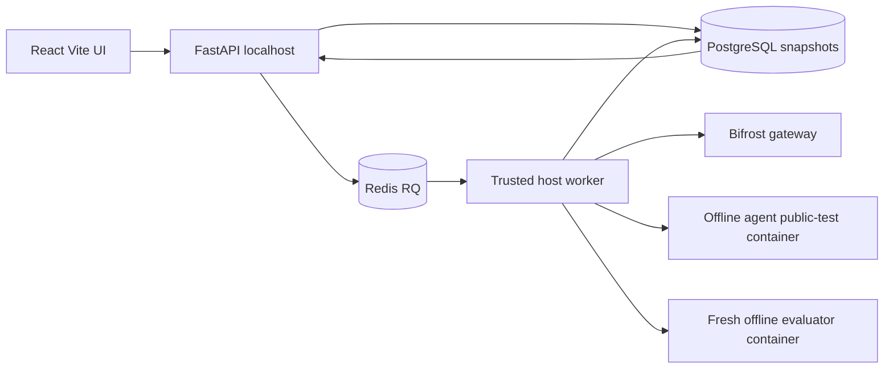
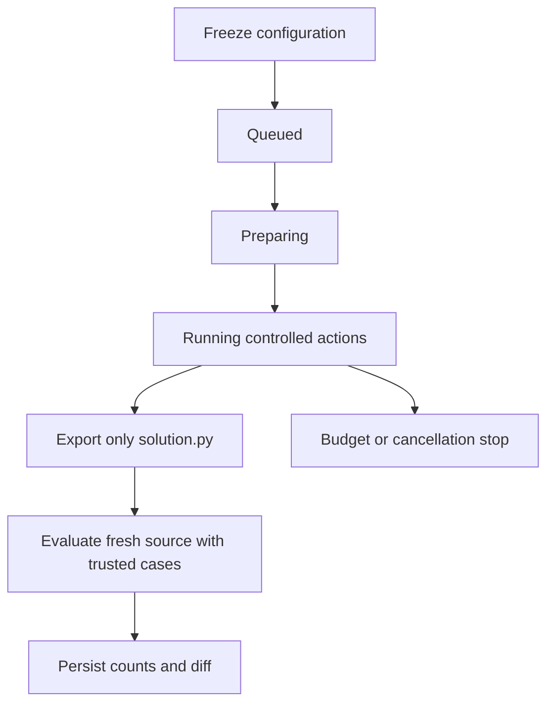

# Architecture

The API validates and queues, never runs submitted code. The trusted host worker alone starts Docker task containers; Bifrost credentials stay in its process. Container mounts contain only source plus one public/evaluator case directory, no credentials or Docker socket. A trusted parent compares JSON output against expected results; candidate-generated reports are never grading evidence. Eval counts return only after the repair loop ends. Public test inputs are part of the documented task contract but case files are mounted only during public verification; source tools see only `solution.py`.

Persistence uses SQLAlchemy bound parameters, an Alembic-created records table with kind, revision and JSON payload. Runs freeze full request configuration; attempts freeze task/environment and pricing. No endpoint mutates started configuration. Logs and diffs are bounded atomic artifact files; records contain safe metadata references. Separate relational tables are follow-up work. SSE sends full persisted snapshots on every new connection, so Last-Event-ID is accepted but replay is snapshot-based, not delta-based. This avoids missed state after refresh.

RQ locks protect duplicate delivery. Queue jobs have deterministic attempt IDs and deadlines. Stale recovery marks interrupted attempts as infrastructure failures. Infrastructure retry count is zero: no silent extra repair attempt. Worker cancellation is polled during sandbox execution. Deadlines are enforced outside the candidate process. API shutdown does not lose persisted attempts.
